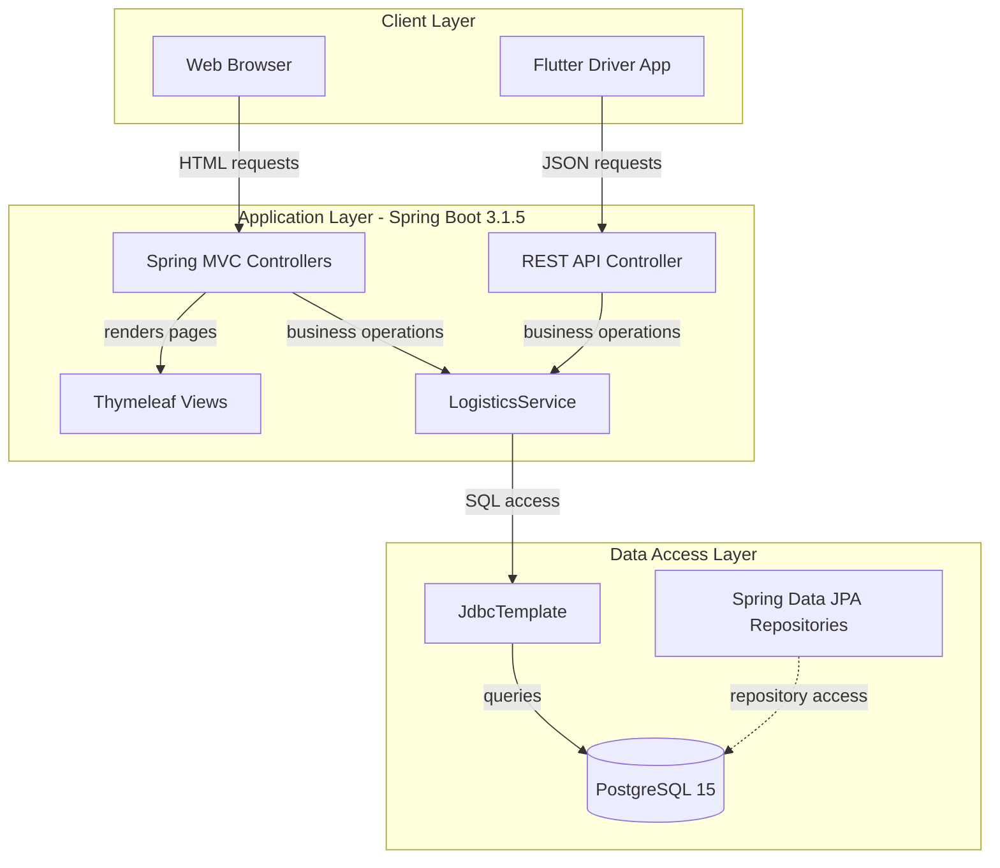
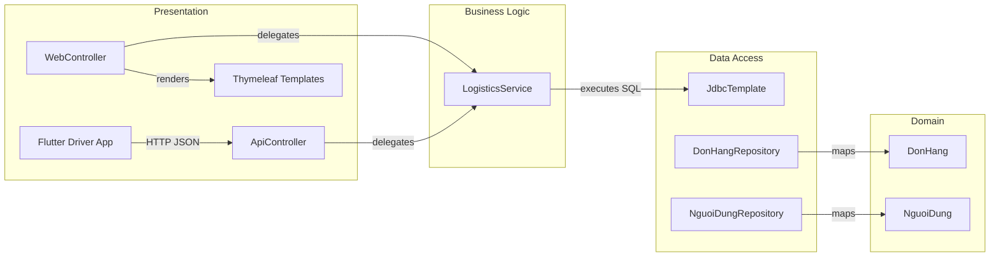

# Architecture Diagram

The project has a Spring Boot web application with server-rendered Thymeleaf pages and a separate Flutter driver app. The diagrams below summarize the implemented application architecture and the organization requested for report section 1.3.

## Application Architecture

<!-- mermaid-checked: no \n, no em-dash/en-dash, no {} in labels, subgraphs are id["label"], arrows are -->|"label"|, all subgraphs closed by end, ids unique -->

### Technology Stack Summary

| Layer | Technology | Version | Purpose |
|---|---|---:|---|
| Web application | Java, Spring Boot | Java 17, Boot 3.1.5 | Runs the web application and its request handlers |
| Web presentation | Thymeleaf, HTML, Tailwind CSS CDN | Thymeleaf from Spring Boot starter | Renders the server-side web interface |
| Driver application | Flutter, Dart, `http` | SDK versions are not pinned in the source files inspected | Provides the separate driver interface and calls the REST API |
| Data access | Spring JDBC, Spring Data JPA | Managed by Spring Boot | Reads and writes application data |
| Data storage | PostgreSQL | 15 in root Docker Compose | Persists application data |

### Data Storage & External Services

The web application is configured to use PostgreSQL. The Flutter driver app communicates with the Spring Boot REST API over HTTP. No external message broker or third-party API integration was identified in the main web module.

### Key Architectural Decisions

- The main web interface is server-rendered through Spring MVC and Thymeleaf.
- The Flutter driver interface is a separate client that communicates with the REST API.
- Request handling is separated into controllers and a business service; repository and JDBC access are used for persistence.

## Component Relationships

<!-- mermaid-checked: no \n, no em-dash/en-dash, no {} in labels, subgraphs are id["label"], arrows are -->|"label"|, all subgraphs closed by end, ids unique -->

### Component Inventory

| Component | Layer | Type | Responsibility |
|---|---|---|---|
| WebController | Presentation | Spring MVC controller | Serves web pages and handles web form actions |
| ApiController | Presentation | REST controller | Exposes API endpoints used by the driver app |
| Thymeleaf templates | Presentation | HTML views | Renders login, registration, dashboard, user administration, and delivery pages |
| Flutter driver app | Presentation | Mobile client | Provides the driver login and shipment workflow |
| LogisticsService | Business Logic | Spring service | Implements logistics operations used by both controllers |
| JdbcTemplate | Data Access | JDBC helper | Executes SQL from service operations |
| DonHangRepository | Data Access | Spring Data repository | Repository interface for order entities |
| NguoiDungRepository | Data Access | Spring Data repository | Repository interface for user entities |
| DonHang and NguoiDung | Domain | Model entities | Represent orders and users |
